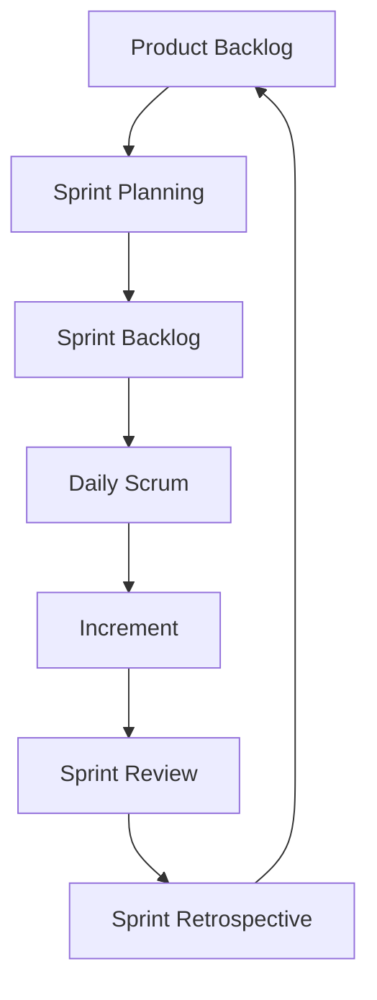
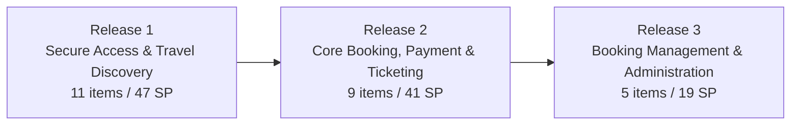
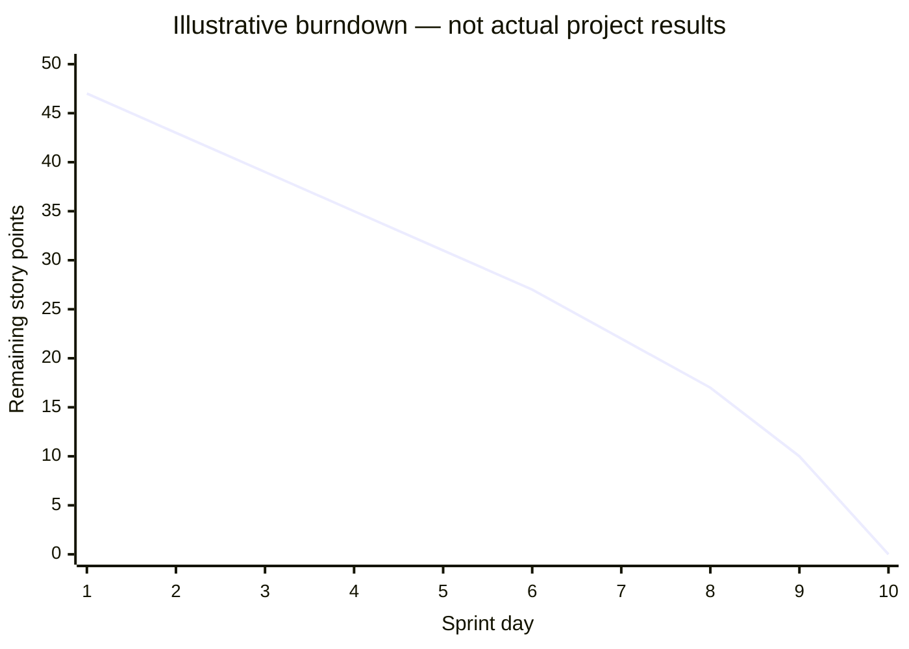

# PROJECT REPORT FOR AGILE DEVELOPMENT PROCESS

**Project Title:** Travel Booking Management System  
**Course Code:** CSE 3001

# DECLARATION / SOURCE STATUS

This report is prepared as an academic project document for Agile Development Process (CSE 3001). The reference attachments named in the brief were not available in the execution workspace. Accordingly, claims that depend on the official report template, assignment tables, presentation slides, workbook sheets, diagrams, or team records are explicitly identified as unverified. The report preserves the project facts stated in the brief and avoids presenting proposed work as completed implementation.

# ACKNOWLEDGEMENT

The preparation of an Agile project report requires the integration of methodological theory, planning artefacts, user-centred analysis and disciplined documentation. This report acknowledges the role of the course materials and project artefacts described in the brief, especially the Product Vision Board, roadmap, backlog, story map, release plan and sprint records. Their inclusion is intended to show how a travel-booking concept can be structured as an inspectable and adaptable Agile product initiative.

# ABSTRACT

This report presents an academic analysis of Agile Development Process through the proposed Travel Booking Management System. It discusses the evolution of Agile, compares traditional and Agile development, explains the Agile Manifesto and principles, and reviews Scrum, Kanban and Extreme Programming. The project-specific chapter translates the stated scope—flights, trains, buses, hotels and cabs, supported by accounts, booking and administration—into a Product Vision, roadmap, Product Backlog, user stories, story map, release plan and sprint-planning discussion. The brief specifies a 25-item selected release scope of 107 story points: 11 items and 47 points in Release 1, 9 items and 41 points in Release 2, and 5 items and 19 points in Release 3. Because the attachments were unavailable for inspection, detailed item names, team lists, workbook figures and source diagrams are marked for confirmation. The report therefore distinguishes verified prompt facts, illustrative examples and proposed planning from completed software, tested features or deployment evidence.

# TABLE OF CONTENTS

Note: update fields in Microsoft Word or LibreOffice to refresh page numbers after editing.

# LIST OF FIGURES

> **Figure 1. Evolution of software development approaches
Figure 2. Scrum cycle used as the project reference model
Figure 3. Illustrative story-map structure
Figure 4. Prompt-specified proposed release allocation
Figure 5. Illustrative burndown chart**

# LIST OF TABLES

Tables are numbered in chapter order and include the methodology comparison, Agile values, principles, framework comparison, project scope, release plan and sprint-planning templates.

# CHAPTER 1 — EVOLUTION OF AGILE METHODOLOGIES

Software development methods have evolved in response to uncertainty, increasing system complexity and the need for earlier user feedback. Early development practices often treated software as an engineering product whose requirements could be fully specified before construction. This assumption was attractive for procurement and control, but it created difficulty when users learned more about their needs during development.

> **Figure 1. Evolution of software development approaches.**

## 1.1 Early and traditional approaches

The sequential or waterfall model divides work into phases such as requirements, analysis, design, implementation, testing and maintenance. Each phase produces documentation and approvals for the next. The model can be appropriate where requirements are stable, compliance evidence is central and change is expensive. Its weakness is that working software and user feedback arrive late, so misunderstandings may remain hidden until integration or acceptance testing.

## 1.2 Limitations of sequential development
- Feedback is delayed until late milestones, increasing the cost of correcting misunderstood requirements.
- Plans can become obsolete when markets, regulations, technology or user expectations change.
- Testing is concentrated near the end, which increases integration risk and reduces time for learning.
- Progress may be measured by documents or phase completion rather than useful, demonstrable product increments.
- Users may be involved primarily at approval points rather than as continuing collaborators.

## 1.3 Emergence and evolution of Agile

Iterative and incremental methods emerged as alternatives to large, one-time delivery. Iteration creates repeated opportunities to plan, build, inspect and adapt. Incremental delivery makes a usable slice of value visible earlier. Agile consolidated these ideas into a family of approaches that value working software, collaboration and responsiveness while retaining appropriate technical discipline.

## 1.4 Relevance to the travel-booking project

A travel platform combines multiple service categories and workflows. Search, comparison, booking, payment, ticketing, cancellation and administration have dependencies, but each can also be explored through small increments. An Agile approach allows the team to validate the user journey progressively rather than assuming that a complete specification of every travel service is correct from the beginning.

# CHAPTER 2 — DIFFERENCE BETWEEN TRADITIONAL AND AGILE METHODOLOGIES

Traditional and Agile methods are not simply opposing labels; they represent different ways of managing uncertainty, feedback and control. A traditional plan emphasises predictive sequencing, while Agile emphasises short learning cycles within a product vision and a prioritised backlog.

| Dimension | Traditional approach | Agile approach |
| --- | --- | --- |
| Development | Sequential phases and hand-offs | Iterative increments |
| Requirements | Specified early; change controlled formally | Evolved through collaboration and refinement |
| Planning | Detailed long-range baseline | Adaptive release and sprint planning |
| Customer involvement | Milestone approvals | Frequent feedback and review |
| Team collaboration | Role and phase boundaries | Cross-functional collaboration |
| Testing | Often concentrated after build | Continuous and integrated with development |
| Delivery | Large release or final handover | Frequent potentially usable increments |
| Flexibility | Change is expensive | Change is expected and prioritised |
| Documentation | Comprehensive upfront documentation | Useful documentation at the right level |
| Risk management | Front-loaded analysis and controls | Early validation and repeated inspection |
| Change management | Formal change requests | Backlog reprioritisation and adaptation |

> **Table 1. Traditional and Agile development comparison.**

For the Travel Booking Management System, the distinction is practical. A change to search filters may affect comparison and booking, but it can be evaluated within a sprint or release boundary. A traditional approach might defer the impact until a later integration phase. Agile does not remove planning; it changes planning from a fixed prediction into a transparent sequence of decisions that can be revisited using evidence.

## 2.1 Managing scope responsibly

Agile flexibility must not be confused with unlimited scope. The Product Backlog makes scope visible, prioritisation makes trade-offs explicit, and the Definition of Done establishes quality expectations. In this project, the brief distinguishes the full Product Backlog from 25 selected items used for story mapping and release planning. That distinction is important because a selected release scope is not automatically the complete product scope.

## 2.2 When traditional controls remain valuable

Travel and payment-related systems may require traceability, privacy controls, audit records and careful release governance. Agile teams can retain these controls while delivering iteratively. The appropriate question is not whether to document, test or approve, but when and at what level those activities create the most value and reduce risk.

# CHAPTER 3 — SIGNIFICANCE OF AGILE METHODOLOGY

Agile is significant because it treats software development as a learning process. The team forms hypotheses about user value, implements a small increment, observes feedback and adapts the backlog. This is especially relevant to a travel booking platform, where users may value speed, comparison clarity, trust, flexibility and confirmation reliability in different ways.

## 3.1 Iterative development

Work is divided into repeatable cycles. Each cycle provides an opportunity to clarify requirements, build a slice, inspect quality and learn.

## 3.2 Incremental delivery

Value is delivered in coherent additions rather than waiting for every feature. A discovery increment may precede booking and payment increments.

## 3.3 Adaptability

New service providers, policies or user expectations can be represented as backlog changes and prioritised against product goals.

## 3.4 Customer collaboration

Feedback from intended users helps validate whether search, comparison and booking flows are understandable.

## 3.5 Transparency

Backlogs, sprint goals, estimates and progress charts create a shared view of work and uncertainty.

## 3.6 Risk reduction

High-risk assumptions, including payment research and ticket-generation reliability, can be investigated early.

## 3.7 Continuous improvement

Retrospectives provide a structured mechanism to improve planning, collaboration, quality and flow.

The significance of Agile is therefore both technical and organisational. It links product decisions with evidence, makes unfinished work visible and encourages teams to improve the way they work rather than only adding more features.

# CHAPTER 4 — AGILE MANIFESTO AND PRINCIPLES

The Agile Manifesto expresses four values. The wording gives greater weight to the item on the left while still recognising the value of the item on the right.

| Value | Interpretation for this project |
| --- | --- |
| Individuals and interactions over processes and tools | Coordination between product, Scrum and development responsibilities is essential when booking workflows cross service categories. |
| Working software over comprehensive documentation | Documentation remains useful, but a demonstrable search or booking increment provides stronger evidence of value. |
| Customer collaboration over contract negotiation | Clarification and feedback should shape backlog decisions. |
| Responding to change over following a plan | Release and sprint plans guide decisions but should adapt when evidence changes priorities. |

> **Table 2. Agile values and project interpretation.**

## 4.1 The twelve principles

| No. | Principle | Project relevance |
| --- | --- | --- |
| 1 | Satisfy the customer through early and continuous delivery of valuable software. | For this project: validate a small, traceable slice of the travel journey and inspect its value or risk. |
| 2 | Welcome changing requirements, even late in development, to create customer advantage. | For this project: validate a small, traceable slice of the travel journey and inspect its value or risk. |
| 3 | Deliver working software frequently, preferring shorter timescales. | For this project: validate a small, traceable slice of the travel journey and inspect its value or risk. |
| 4 | Business people and developers work together throughout the project. | For this project: validate a small, traceable slice of the travel journey and inspect its value or risk. |
| 5 | Build projects around motivated individuals and provide support and trust. | For this project: validate a small, traceable slice of the travel journey and inspect its value or risk. |
| 6 | The most effective communication is face-to-face conversation. | For this project: validate a small, traceable slice of the travel journey and inspect its value or risk. |
| 7 | Working software is the primary measure of progress. | For this project: validate a small, traceable slice of the travel journey and inspect its value or risk. |
| 8 | Agile processes promote sustainable development at a constant pace. | For this project: validate a small, traceable slice of the travel journey and inspect its value or risk. |
| 9 | Continuous attention to technical excellence and good design enhances agility. | For this project: validate a small, traceable slice of the travel journey and inspect its value or risk. |
| 10 | Simplicity—the art of maximising the amount of work not done—is essential. | For this project: validate a small, traceable slice of the travel journey and inspect its value or risk. |
| 11 | The best architectures, requirements and designs emerge from self-organising teams. | For this project: validate a small, traceable slice of the travel journey and inspect its value or risk. |
| 12 | At regular intervals, the team reflects and tunes its behaviour to become more effective. | For this project: validate a small, traceable slice of the travel journey and inspect its value or risk. |

> **Table 3. The twelve Agile principles with project relevance.**

The principles do not authorise unsupported claims. In this report, proposed releases, illustrative charts and theoretical ceremonies are labelled accordingly. This is itself an Agile discipline: transparency about evidence is necessary for reliable inspection and adaptation.

# CHAPTER 5 — AGILE METHODOLOGIES: ROLES AND RESPONSIBILITIES

Agile roles clarify accountability without creating rigid silos. The Scrum framework identifies the Product Owner, Scrum Master and Developers as accountabilities within a Scrum Team. The exact individuals and registration numbers for the project could not be verified because the named attachments were unavailable.

| Role | Core responsibilities | Application to project |
| --- | --- | --- |
| Product Owner | Maximise product value; order the Product Backlog; clarify goals and acceptance expectations. | Prioritise travel discovery, booking, payment/ticketing and administration outcomes. |
| Scrum Master | Help establish Scrum; coach the team; remove impediments; support empirical process control. | Protect focus, facilitate inspection and ensure that planning is realistic. |
| Developers | Create the usable increment; plan technical work; maintain quality and adapt daily. | Design, implement, test and integrate the selected travel-booking slice. |

> **Table 4. Scrum roles and responsibilities.**

## 5.1 Collaboration and communication

The roles collaborate through backlog refinement, sprint planning, daily coordination, review and retrospective. The Product Owner does not act as a requirements secretary; the role makes value and ordering decisions. The Scrum Master does not manage individual tasks; the role improves the system in which the team works. Developers do not merely receive requirements; they contribute to estimation, design, risk identification and quality.

## 5.2 Team details requiring confirmation

The brief instructs that team members and registration numbers must be taken from authoritative submission materials and that conflicting lists must be flagged. No authoritative list was accessible in this workspace. The final academic submission should replace the confirmation note with the verified list from the official project submission.

# CHAPTER 6 — OVERVIEW OF POPULAR AGILE FRAMEWORKS

## 6.1 Scrum

Scrum is a lightweight framework for generating value through adaptive solutions to complex problems. It uses a Product Goal, Product Backlog, Sprint Backlog and Increment, supported by Sprint Planning, Daily Scrum, Sprint Review and Sprint Retrospective. The project brief explicitly states that the Travel Booking Management System follows Scrum.

> **Figure 2. Scrum cycle used as the project reference model.**

## 6.2 Kanban

Kanban visualises work, limits work in progress and improves flow. A Kanban board might represent discovery, ready, in progress, review, testing and done. It is valuable when priorities arrive continuously or when flow time is more important than a fixed sprint cadence. Its flexibility can be an advantage, but teams must define policies and manage work-in-progress deliberately.

## 6.3 Extreme Programming (XP)

XP emphasises engineering practices such as pair programming, test-driven development, continuous integration, refactoring, simple design and frequent feedback. These practices can strengthen a Scrum implementation even when the team does not adopt XP as its overall management framework.

## 6.4 Framework comparison

| Dimension | Scrum | Kanban | XP |
| --- | --- | --- | --- |
| Primary structure | Timeboxed Sprints | Continuous flow | Engineering discipline |
| Planning | Sprint and release planning | Pull-based replenishment | Short cycles and technical feedback |
| Visual control | Sprint Backlog and increment | Flow board and WIP limits | Tests, integration and code practices |
| Best fit | Complex product development | Variable incoming work | High technical change and quality needs |
| Limitation | Can become ceremony-focused | Can lack cadence if policies are weak | Requires strong technical discipline |

> **Table 5. Scrum, Kanban and XP comparison.**

For this project, Scrum provides the principal framework because the brief identifies Scrum process, release planning and sprint artefacts. Kanban and XP are useful complementary ideas: visualising work and limiting WIP can improve flow, while XP practices can support reliable search, booking, cancellation and ticketing behaviour.

# CHAPTER 7 — AGILE IMPLEMENTATION THROUGH A GROUP PROJECT

## 7.1 Project title

Travel Booking Management System.

## 7.2 Introduction

The proposed system is a unified travel platform covering flights, trains, buses, hotels and cabs, together with user accounts, booking and administration. The problem context is fragmentation: travellers may need to search several service categories, compare options, maintain booking details and obtain confirmation or ticket information through a coherent journey. The stated scope is a proposed product concept and planning artefact, not evidence that the system was implemented, deployed or operational.

| Scope area | Intended capability | Evidence status |
| --- | --- | --- |
| Accounts and access | Registration, login and role-aware access | Project scope stated in brief; implementation unverified |
| Travel discovery | Search across travel service categories | Proposed capability; detailed source tables unavailable |
| Comparison | Compare options using relevant details | Proposed capability |
| Booking | Capture booking details and confirmation | Proposed capability |
| Payment and ticketing | Research and plan payment/ticketing flow | PB-27/PB-28 are research spikes; gateway integration unverified |
| Management | Cancellation/status and administration | Proposed capability |

> **Table 6. Project scope and evidence status.**

## 7.3 Product Vision

The Product Vision Board connects the desired future state to the people served, their needs, the product response and business goals. The brief requires five sections: Vision, Target Group, Needs, Product and Business Goals. The exact board contents were not accessible, so the following wording is a structured reconstruction from the project scope stated in the brief and must be checked against the assignment PDF.

| Section | Reconstructed project statement | Verification status |
| --- | --- | --- |
| Vision | Provide a unified, convenient travel-booking experience across major travel service categories. | Based on brief; verify against original board |
| Target Group | Travellers and administrators responsible for managing travel services and bookings. | Based on brief; verify exact wording |
| Needs | Discover options, compare alternatives, book accurately, receive confirmation/ticket information and manage bookings. | Based on brief; verify exact wording |
| Product | A travel booking management platform supporting accounts, search, comparison, booking, payment/ticketing and administration. | Based on brief; verify exact wording |
| Business Goals | Create a coherent product foundation, prioritise valuable increments and reduce uncertainty through Agile planning. | Interpretive; verify source goals |

> **Table 7. Product Vision Board reconstruction for verification.**

## 7.4 Roadmap creation

A product roadmap communicates direction over a sequence of proposed outcomes. It is not a promise that every date or feature will be completed. Roadmap goals should be established from the Product Vision, target-user needs, dependencies, risk and expected value. Features can then be grouped into releases that produce coherent outcomes.

| Proposed release | Goal | Planning interpretation |
| --- | --- | --- |
| Release 1 | Secure Access & Travel Discovery | Establish access and enable users to discover travel services; 11 selected items, 47 SP. |
| Release 2 | Core Booking, Payment & Ticketing | Extend discovery into booking and ticketing; 9 selected items, 41 SP. |
| Release 3 | Booking Management & Administration | Support post-booking management and administrative capabilities; 5 selected items, 19 SP. |

> **Table 8. Proposed three-release roadmap specified in the brief.**

> **Figure 4. Prompt-specified proposed release allocation.**

## 7.5 Product Backlog

The Product Backlog is an ordered, evolving list of work needed to improve the product. It can contain user stories, epics, defects, technical work and research spikes. The brief identifies a full Product Backlog in the workbook and a separate selected scope of 25 items for the story map and release plan. These must not be conflated.

| Backlog concept | Meaning in this project |
| --- | --- |
| Item type | The brief explicitly identifies PB-04 as an Epic and PB-27/PB-28 as research spikes. |
| Priority | Ordering should reflect user value, dependency and risk rather than only convenience. |
| Story points | Relative estimate of effort, complexity and uncertainty; not hours and not proof of completion. |
| Refinement | Clarify purpose, acceptance criteria, dependencies and size before selection. |
| Traceability | IDs connect backlog items to story-map activities and release planning. |

> **Table 9. Product Backlog organisation.**

The full workbook backlog and exact item names were unavailable for inspection. The final report must insert the authoritative Product Backlog table and retain original IDs and names. The brief confirms specific payment-related items: PB-27 Research UPI Payment Flow, PB-28 Research Card Payment Flow, PB-04 Payment & Ticketing (Epic), PB-19 Booking Confirmation and PB-35 Fix Ticket Generation Failure.

## 7.6 User stories

A user story describes a capability from a user or stakeholder perspective. A common form is: “As a [user], I want [functionality], so that [benefit].” Acceptance criteria make the expected behaviour observable. For example, a discovery story might state: “As a traveller, I want to search available travel services, so that I can identify suitable options before booking.” The exact backlog item must be checked against the source before final submission.

| Story quality question | Example for travel booking |
| --- | --- |
| Who benefits? | Traveller, administrator or another defined role. |
| What capability is needed? | Search, compare, book, confirm, cancel or administer. |
| Why does it matter? | Reduces effort, improves confidence or supports accurate operations. |
| How is it accepted? | Observable success and failure conditions, including invalid input handling. |
| What is the priority? | Value, dependency, risk and release goal. |

> **Table 10. User-story analysis questions.**

## 7.7 User Story Mapping

Story mapping arranges the user journey horizontally and the supporting detail vertically. The brief identifies seven activities: Account & Access; Search Travel Services; Compare Travel Options; Booking & Booking Details; Payment & Ticketing; Booking Management; Administration. A map helps the team see the backbone of the experience, identify a minimum valuable slice and trace selected backlog items into releases.

> **Figure 3. Illustrative story-map structure; item IDs and labels require verification against the assignment PDF.**

| Activity | Typical capability questions | Traceability requirement |
| --- | --- | --- |
| Account & Access | Can users register, log in and access appropriate functions? | Insert original PB IDs from source map. |
| Search Travel Services | Can users search flights, trains, buses, hotels and cabs? | Retain exact IDs and names. |
| Compare Travel Options | Can options be compared clearly? | Map to selected items. |
| Booking & Booking Details | Can booking data be captured and confirmed? | Distinguish epic from stories. |
| Payment & Ticketing | What payment flow is planned and what is research? | Keep PB-27/PB-28 as spikes. |
| Booking Management | Can users view or manage booking status? | Map cancellation/status items. |
| Administration | Can authorised administrators manage relevant data? | Retain role-related items. |

> **Table 11. Story-map activities and traceability checks.**

## 7.8 Release planning

Release planning groups ordered backlog items into outcomes that can be evaluated. The exact allocation specified by the brief is 25 selected items and 107 story points. Release 1 contains 11 items and 47 SP; Release 2 contains 9 items and 41 SP; Release 3 contains 5 items and 19 SP. These are proposed planning figures, not completion evidence.

| Release | Items | Story points | Goal | Dependency logic |
| --- | --- | --- | --- | --- |
| 1 | 11 | 47 | Secure Access & Travel Discovery | Access and discovery precede booking. |
| 2 | 9 | 41 | Core Booking, Payment & Ticketing | Booking depends on discovery; payment/ticketing includes research and reliability concerns. |
| 3 | 5 | 19 | Booking Management & Administration | Post-booking and administrative functions build on core booking data. |
| Total | 25 | 107 | Selected release-planning scope | Selected scope is not necessarily the full backlog. |

> **Table 12. Exact release totals specified in the brief.**

## 7.9 Sprint Backlog and Sprint Planning

A Sprint Backlog is the Sprint Goal, selected Product Backlog items and an actionable plan for delivering the Increment. Sprint Planning asks why the sprint is valuable, what can be done and how the work will be accomplished. The Excel workbook is said to contain Sprint 1, Sprint 2, Sprint 3 and Sprint Summary sheets, but it was not accessible. Therefore, no detailed sprint figures or completed tasks are claimed here.

| Sprint artifact | Required evidence from workbook | Report treatment |
| --- | --- | --- |
| Sprint 1 | Goal, selected items, tasks, estimates and status | Insert exact values; do not infer completion. |
| Sprint 2 | Goal, selected items, tasks, estimates and status | Compare with release grouping. |
| Sprint 3 | Goal, selected items, tasks, estimates and status | Identify dependencies and unresolved work. |
| Sprint Summary | Summary figures and assignments | Reconcile with detailed sheets and disclose discrepancies. |

> **Table 13. Sprint-sheet verification framework.**

If the Sprint Summary conflicts with detailed sprint sheets, the final report should show both values, identify the affected item or total, explain which sheet is treated as authoritative for which purpose, and retain the discrepancy note. Sprint assignments must also remain distinct from release groupings: a release is a product-level outcome grouping, while a sprint is a timeboxed planning unit.

## 7.10 Burn charts

A burndown chart shows remaining work over time; a burnup chart shows completed work and often the total scope. Both support inspection but neither proves product quality on its own. The chart below is explicitly illustrative because actual chart data was not available.

> **Figure 5. Illustrative burndown chart; values are not actual project results.**

## 7.11 Daily stand-ups, Sprint Reviews and Retrospectives

The Daily Scrum is a short event for Developers to inspect progress toward the Sprint Goal and adapt the plan. A Sprint Review inspects the Increment with stakeholders and discusses what to do next. A Sprint Retrospective focuses on quality and effectiveness, selecting improvements for the next cycle. These events should be described as theoretical Scrum practices unless meeting records, dates, attendance or decisions are available. No such records were accessible, so this report does not claim that ceremonies occurred.

## 7.12 Agile testing vs traditional testing

Agile testing is continuous, collaborative and aligned with incremental delivery. Testing begins with examples and acceptance expectations, continues through implementation and regression, and informs backlog decisions. Traditional testing may be organised as a later phase after construction. Both approaches can include rigorous testing; the difference is when and how feedback influences development.

| Scenario | Example checks | Evidence status |
| --- | --- | --- |
| Registration and login | Valid registration, invalid credentials, session and role behaviour | Test design example only |
| Travel search | Valid search, empty inputs, unsupported combinations and no-result handling | Test design example only |
| Booking details | Required fields, consistency and confirmation summary | Test design example only |
| Ticket generation | Correct ticket data, failure handling and retry/visibility | PB-35 is identified; passed result unverified |
| Cancellation status | Correct state transition and user-facing status | Test design example only |
| Role-based access | Authorised and unauthorised actions | Test design example only |

> **Table 14. Agile testing examples for the proposed system.**

PB-27 and PB-28 are research spikes for UPI and card payment flows. They must not be represented as completed gateway integrations. PB-04 remains an Epic, PB-19 concerns booking confirmation, and PB-35 concerns fixing ticket-generation failure. The source brief provides scope relationships but not test evidence or pass rates.

## 7.13 Available tools and techniques
- Product Backlog for ordered product work.
- Sprint Backlog for timeboxed execution planning.
- User Story Mapping for journey and traceability.
- Release Planning and roadmap for outcome sequencing.
- Story Points for relative estimation.
- Burndown and burnup charts for progress inspection.
- Task tracking, collaboration, reviews and retrospectives for transparency and improvement.

Specific software such as Jira, Trello, GitHub or cloud infrastructure is not claimed because the supplied brief does not establish that those tools were used. The final report may add them only when supported by the project materials.

## 7.14 Scaling Scrum for large projects

Scaling becomes relevant when several Scrum Teams work on one product. Common needs include a shared Product Goal, coherent Product Backlog, cross-team dependency management, integrated increments, compatible quality standards and communication mechanisms that avoid excessive ceremony. Approaches such as Scrum of Scrums, Nexus, LeSS or the Scrum@Scale pattern provide different coordination ideas. This project is not claimed to have implemented scaled Scrum; the discussion is theoretical.

## 7.15 Best practices for managing Scrum
- Maintain a clear Product Goal and an ordered, refined backlog.
- Write user stories with explicit value and acceptance criteria.
- Use dependencies and risk to inform ordering.
- Plan a realistic Sprint Goal rather than maximising item count.
- Keep roles accountable and communication direct.
- Integrate testing and quality into the Definition of Done.
- Use reviews for feedback and retrospectives for improvement.
- Track progress transparently without treating charts as proof of quality.
- Deliver coherent increments and preserve traceability from vision to backlog to release.

# CHAPTER 8 — CHALLENGES ENCOUNTERED

The attachments were not available, so this chapter distinguishes anticipated challenges from documented experience. It does not claim that the project team encountered or resolved the following issues.

| Potential challenge | Why it matters | Mitigation strategy |
| --- | --- | --- |
| Multiple travel categories | Different search fields, availability rules and booking constraints can make a unified experience inconsistent. | Define shared journey concepts while preserving service-specific rules; validate each category incrementally. |
| Accurate booking data | Errors can affect dates, travellers, prices, availability and confirmation. | Use explicit validation, traceable acceptance criteria and clear confirmation summaries. |
| Invalid or empty search results | Users need understandable feedback and recovery options. | Specify negative scenarios and test boundary conditions early. |
| Privacy and access | Accounts and booking information require appropriate role and access controls. | Prioritise threat-aware design, least privilege and auditable actions. |
| Payment and ticketing dependencies | Research, gateway behaviour and ticket generation can create uncertainty. | Treat PB-27/PB-28 as spikes, retain PB-04 as an Epic and inspect PB-35 as reliability work. |
| Backlog prioritisation | The full backlog and selected 25-item release scope may be confused. | Maintain explicit traceability and label proposed scope. |
| Team coordination | Different interpretations can create duplicate or incompatible work. | Use shared definitions, refinement and short feedback cycles. |
| Testing breadth | Several travel workflows and roles increase regression risk. | Automate where appropriate, use acceptance examples and test incrementally. |

> **Table 15. Anticipated project challenges and mitigation strategies.**

A mature Agile response to challenge is not to hide uncertainty. It is to expose the assumption, select an appropriate experiment or backlog item, define the evidence needed and adapt based on the result. This is particularly important for payment research and ticket-generation reliability.

# CONCLUSION

This report has presented Agile Development Process through the proposed Travel Booking Management System. Agile evolved as a response to the limitations of purely sequential delivery, but its value is not simply speed. Its central contribution is an empirical way to manage uncertainty through prioritised work, short feedback cycles, transparent progress and continuous improvement.

The project applies Scrum as the stated framework. The Product Vision provides direction; the roadmap and three proposed releases organise outcomes; the Product Backlog represents evolving work; user stories express user-centred value; the story map arranges the seven major activities of the travel journey; and sprint planning translates selected items into timeboxed execution plans. The brief specifies a selected scope of 25 items and 107 story points across three releases, while also warning that proposed work must not be presented as completed implementation.

The project-specific analysis also demonstrates why source discipline matters. Payment research spikes are not gateway integrations, an Epic is not a user story, release groupings are not sprint assignments, and illustrative charts are not actual results. A final submission should replace the marked verification points with the authoritative assignment PDF, workbook, presentations and team records. Once those materials are available, the report can retain its structure while inserting exact backlog names, diagrams, sprint figures, source-specific dates and confirmed team details.

# REFERENCES
1. Agile Manifesto. (2001). Manifesto for Agile Software Development. https://agilemanifesto.org/
1. Beck, K., et al. (2001). Principles behind the Agile Manifesto. https://agilemanifesto.org/principles.html
1. Schwaber, K., & Sutherland, J. (2020). The Scrum Guide: The definitive guide to Scrum: The rules of the game. https://scrumguides.org/
1. Beck, K. (2004). Test-driven development: By example. Addison-Wesley.
1. Cockburn, A. (2006). Agile software development: The cooperative game (2nd ed.). Addison-Wesley.
1. Poppendieck, M., & Poppendieck, T. (2003). Lean software development: An agile toolkit. Addison-Wesley.
1. Sommerville, I. (2016). Software engineering (10th ed.). Pearson.
1. ISTQB. (2018). Certified tester foundation level syllabus. International Software Testing Qualifications Board.
1. Internal project materials named in the brief: official CSE 3001 report format; assignment PDF; project presentations; Excel backlog and sprint workbook. Exact bibliographic metadata requires verification from the attachments.

# APPENDIX A — PRODUCT BACKLOG SUMMARY TEMPLATE

This appendix is a structured insertion point for the complete Product Backlog sheet. The original workbook was unavailable; therefore, no unverified rows are fabricated. Insert every original ID, item name, type, priority, necessity, story points and status, preserving source wording.

| Field | Required treatment |
| --- | --- |
| ID | Preserve original PB identifier. |
| Item name | Copy exact source wording. |
| Type | Retain Epic, Story, Spike, Defect or other source label. |
| Priority / necessity | Retain original values and explain ordering. |
| Story points | Retain exact estimate; do not equate to hours. |
| Traceability | Link to story-map activity and release where applicable. |
| Status | Retain source status; do not convert To Do into completed. |

# APPENDIX B — SPRINT BACKLOG SUMMARY TEMPLATE

Use one table per sprint and a separate reconciliation table for Sprint Summary versus detailed sheets. Record goal, selected backlog items, tasks, estimates, status and unresolved work. Distinguish source-reported assignment from interpretation.

| Sprint | Goal | Selected items | Tasks | Points | Status | Verification |
| --- | --- | --- | --- | --- | --- | --- |
| Sprint 1 | Insert source value | Insert source value | Insert source value | Insert source value | Insert source value | Required |
| Sprint 2 | Insert source value | Insert source value | Insert source value | Insert source value | Insert source value | Required |
| Sprint 3 | Insert source value | Insert source value | Insert source value | Insert source value | Insert source value | Required |

# APPENDIX C — STORY MAP TRACEABILITY TEMPLATE

The story map must reproduce the seven activities and all 25 selected items with original IDs. The traceability index should make it possible to move from a backlog item to its activity, release, story-map position and evidence. The illustrative diagram in Chapter 7 is not a substitute for the original assignment diagram.

| Activity | Source item IDs | Release | Notes |
| --- | --- | --- | --- |
| Account & Access | Insert exact IDs | R1 | Verify against assignment |
| Search Travel Services | Insert exact IDs | R1 | Verify against assignment |
| Compare Travel Options | Insert exact IDs | R1 | Verify against assignment |
| Booking & Booking Details | Insert exact IDs | R2 | Verify against assignment |
| Payment & Ticketing | PB-27, PB-28, PB-04, PB-19, PB-35 as applicable | R2 | Preserve spike and Epic distinctions |
| Booking Management | Insert exact IDs | R3 | Verify against assignment |
| Administration | Insert exact IDs | R3 | Verify against assignment |

# APPENDIX D — RELEASE PLANNING EVIDENCE

The release evidence should show the exact three-release allocation and the dependency logic. The figures stated in the brief are 11 items / 47 SP, 9 items / 41 SP and 5 items / 19 SP, for a total of 25 items / 107 SP. Add the source tables and original roadmap dates after verification.

| Release | Items | SP | Goal | Source date(s) | Verification |
| --- | --- | --- | --- | --- | --- |
| 1 | 11 | 47 | Secure Access & Travel Discovery | Insert source dates | Prompt fact; dates unverified |
| 2 | 9 | 41 | Core Booking, Payment & Ticketing | Insert source dates | Prompt fact; dates unverified |
| 3 | 5 | 19 | Booking Management & Administration | Insert source dates | Prompt fact; dates unverified |

# APPENDIX E — QUALITY AND TESTING CHECKLIST

This checklist supports disciplined reporting without claiming test completion. Mark each item only when evidence exists in the source materials or project records.

| Area | Checklist item | Evidence reference | Status |
| --- | --- | --- | --- |
| Access | Registration and login cases defined | Insert reference | Not verified |
| Discovery | Valid, invalid and no-result search cases defined | Insert reference | Not verified |
| Booking | Details and confirmation acceptance criteria defined | Insert reference | Not verified |
| Payment | Research spikes separated from integration claims | Brief PB-27/PB-28 | Confirmed from brief |
| Ticketing | Failure and recovery behaviour documented | Brief PB-35 | Scope identified; outcome unverified |
| Administration | Role-based access cases defined | Insert reference | Not verified |

# APPENDIX F — SOURCE VERIFICATION AND REPORTING NOTES

Source limitations identified during report preparation: the named PDF, XLSX and PPTX attachments were not present in the accessible workspace. Consequently, the official report-format chapter wording, original Product Vision Board, exact 25 backlog rows and IDs, roadmap dates, sprint-sheet figures, Sprint Summary discrepancies, presentation diagrams, and authoritative team list could not be independently checked. This report uses only the explicit facts in the user brief and genuine public references listed above.

| Item requiring confirmation | Why confirmation is needed |
| --- | --- |
| Team members and registration numbers | Brief warns that attachment lists may differ. |
| Exact Product Vision Board wording | Reconstruction is based only on the stated scope. |
| All 25 selected backlog items | Only totals and named payment items are present in the brief. |
| Sprint 1–3 and Sprint Summary figures | Workbook unavailable; no actual sprint outcomes claimed. |
| Roadmap dates | Dates described as proposed but not supplied in accessible content. |
| Figures and diagrams | Illustrations are labelled and should be replaced by source artefacts where required. |

# APPENDIX G — SUPPORTING ANALYSIS WORKSHEET

This worksheet provides a practical academic structure for documenting the project without inventing evidence. Each row should be completed from the authoritative project artefact and linked to a backlog ID, release goal or acceptance criterion.

| Analysis field | Guiding question | Project-specific prompt |
| --- | --- | --- |
| Outcome | What user or business outcome is intended? | How does this improve travel discovery, booking or management? |
| Assumption | What must be true for the item to create value? | What availability, role or data assumption is involved? |
| Risk | What could make the item fail or become costly? | Could a dependency, payment flow or ticketing issue intervene? |
| Evidence | What would convince the team? | Which table, test, review or source record supports the claim? |
| Adaptation | What decision follows from evidence? | Should the item be refined, reordered, split or deferred? |

The worksheet reinforces the report’s central principle: a professional Agile report distinguishes intention, plan, evidence and result. It should be completed with source-backed information rather than assumptions.

# APPENDIX H — SUPPORTING ANALYSIS WORKSHEET

This worksheet provides a practical academic structure for documenting the project without inventing evidence. Each row should be completed from the authoritative project artefact and linked to a backlog ID, release goal or acceptance criterion.

| Analysis field | Guiding question | Project-specific prompt |
| --- | --- | --- |
| Outcome | What user or business outcome is intended? | How does this improve travel discovery, booking or management? |
| Assumption | What must be true for the item to create value? | What availability, role or data assumption is involved? |
| Risk | What could make the item fail or become costly? | Could a dependency, payment flow or ticketing issue intervene? |
| Evidence | What would convince the team? | Which table, test, review or source record supports the claim? |
| Adaptation | What decision follows from evidence? | Should the item be refined, reordered, split or deferred? |

The worksheet reinforces the report’s central principle: a professional Agile report distinguishes intention, plan, evidence and result. It should be completed with source-backed information rather than assumptions.

# APPENDIX I — SUPPORTING ANALYSIS WORKSHEET

This worksheet provides a practical academic structure for documenting the project without inventing evidence. Each row should be completed from the authoritative project artefact and linked to a backlog ID, release goal or acceptance criterion.

| Analysis field | Guiding question | Project-specific prompt |
| --- | --- | --- |
| Outcome | What user or business outcome is intended? | How does this improve travel discovery, booking or management? |
| Assumption | What must be true for the item to create value? | What availability, role or data assumption is involved? |
| Risk | What could make the item fail or become costly? | Could a dependency, payment flow or ticketing issue intervene? |
| Evidence | What would convince the team? | Which table, test, review or source record supports the claim? |
| Adaptation | What decision follows from evidence? | Should the item be refined, reordered, split or deferred? |

The worksheet reinforces the report’s central principle: a professional Agile report distinguishes intention, plan, evidence and result. It should be completed with source-backed information rather than assumptions.

# APPENDIX J — SUPPORTING ANALYSIS WORKSHEET

This worksheet provides a practical academic structure for documenting the project without inventing evidence. Each row should be completed from the authoritative project artefact and linked to a backlog ID, release goal or acceptance criterion.

| Analysis field | Guiding question | Project-specific prompt |
| --- | --- | --- |
| Outcome | What user or business outcome is intended? | How does this improve travel discovery, booking or management? |
| Assumption | What must be true for the item to create value? | What availability, role or data assumption is involved? |
| Risk | What could make the item fail or become costly? | Could a dependency, payment flow or ticketing issue intervene? |
| Evidence | What would convince the team? | Which table, test, review or source record supports the claim? |
| Adaptation | What decision follows from evidence? | Should the item be refined, reordered, split or deferred? |

The worksheet reinforces the report’s central principle: a professional Agile report distinguishes intention, plan, evidence and result. It should be completed with source-backed information rather than assumptions.

# APPENDIX K — SUPPORTING ANALYSIS WORKSHEET

This worksheet provides a practical academic structure for documenting the project without inventing evidence. Each row should be completed from the authoritative project artefact and linked to a backlog ID, release goal or acceptance criterion.

| Analysis field | Guiding question | Project-specific prompt |
| --- | --- | --- |
| Outcome | What user or business outcome is intended? | How does this improve travel discovery, booking or management? |
| Assumption | What must be true for the item to create value? | What availability, role or data assumption is involved? |
| Risk | What could make the item fail or become costly? | Could a dependency, payment flow or ticketing issue intervene? |
| Evidence | What would convince the team? | Which table, test, review or source record supports the claim? |
| Adaptation | What decision follows from evidence? | Should the item be refined, reordered, split or deferred? |

The worksheet reinforces the report’s central principle: a professional Agile report distinguishes intention, plan, evidence and result. It should be completed with source-backed information rather than assumptions.

# APPENDIX L — SUPPORTING ANALYSIS WORKSHEET

This worksheet provides a practical academic structure for documenting the project without inventing evidence. Each row should be completed from the authoritative project artefact and linked to a backlog ID, release goal or acceptance criterion.

| Analysis field | Guiding question | Project-specific prompt |
| --- | --- | --- |
| Outcome | What user or business outcome is intended? | How does this improve travel discovery, booking or management? |
| Assumption | What must be true for the item to create value? | What availability, role or data assumption is involved? |
| Risk | What could make the item fail or become costly? | Could a dependency, payment flow or ticketing issue intervene? |
| Evidence | What would convince the team? | Which table, test, review or source record supports the claim? |
| Adaptation | What decision follows from evidence? | Should the item be refined, reordered, split or deferred? |

The worksheet reinforces the report’s central principle: a professional Agile report distinguishes intention, plan, evidence and result. It should be completed with source-backed information rather than assumptions.

# APPENDIX M — ACCEPTANCE CRITERIA WORKSHEETS

This evidence-oriented appendix supports the project report without fabricating source facts. Registration, login and access should be completed or replaced using the authoritative project artefact before final academic submission.

| Scenario | Given/When/Then structure | Evidence to attach |
| --- | --- | --- |
| Registration | Given valid required data, when registration is submitted, then an account outcome is shown clearly. | Source story and test record |
| Login failure | Given invalid credentials, when login is attempted, then access is denied and recovery guidance is visible. | Acceptance record |
| Role access | Given a defined role, when a restricted action is requested, then only authorised behaviour is permitted. | Role matrix |

> **Table M — ACCEPTANCE CRITERIA WORKSHEETS supporting worksheet.**

# APPENDIX N — ACCEPTANCE CRITERIA WORKSHEETS

This evidence-oriented appendix supports the project report without fabricating source facts. Travel discovery and comparison should be completed or replaced using the authoritative project artefact before final academic submission.

| Scenario | Given/When/Then structure | Evidence to attach |
| --- | --- | --- |
| Valid search | Given valid criteria, when search is submitted, then matching options are listed with relevant details. | Search story and test record |
| No results | Given criteria with no match, when search completes, then a clear no-result state and recovery option are shown. | Negative-case evidence |
| Comparison | Given selected options, when comparison is requested, then differences are understandable and traceable. | Comparison acceptance record |

> **Table N — ACCEPTANCE CRITERIA WORKSHEETS supporting worksheet.**

# APPENDIX O — ACCEPTANCE CRITERIA WORKSHEETS

This evidence-oriented appendix supports the project report without fabricating source facts. Booking, confirmation and ticketing should be completed or replaced using the authoritative project artefact before final academic submission.

| Scenario | Given/When/Then structure | Evidence to attach |
| --- | --- | --- |
| Booking details | Given a selected option, when required details are entered, then validation identifies omissions and inconsistencies. | Booking story |
| Confirmation | Given a valid booking, when confirmation is produced, then the summary is accurate and retrievable. | PB-19 evidence |
| Ticket failure | Given ticket generation fails, when the failure is surfaced, then status and recovery are explicit. | PB-35 evidence |

> **Table O — ACCEPTANCE CRITERIA WORKSHEETS supporting worksheet.**

# APPENDIX P — PAYMENT RESEARCH SPIKE RECORD

This evidence-oriented appendix supports the project report without fabricating source facts. PB-27 Research UPI Payment Flow should be completed or replaced using the authoritative project artefact before final academic submission.

| Field | Required record | Reason |
| --- | --- | --- |
| Question | What UPI flow and constraints must be understood? | Spike must reduce uncertainty. |
| Assumption | Which provider, user journey or compliance condition is in scope? | Avoid gateway claims. |
| Output | Documented findings, open questions and recommendation. | Research is not integration. |
| Decision | Which backlog item or architecture decision follows? | Connect learning to ordering. |

> **Table P — PAYMENT RESEARCH SPIKE RECORD supporting worksheet.**

# APPENDIX Q — PAYMENT RESEARCH SPIKE RECORD

This evidence-oriented appendix supports the project report without fabricating source facts. PB-28 Research Card Payment Flow should be completed or replaced using the authoritative project artefact before final academic submission.

| Field | Required record | Reason |
| --- | --- | --- |
| Question | What card flow, failure handling and security constraints must be understood? | Spike must reduce uncertainty. |
| Assumption | Which payment boundary is proposed? | Avoid claiming operation. |
| Output | Documented findings and risks. | Research evidence. |
| Decision | What should be refined or prioritised next? | Adapt backlog. |

> **Table Q — PAYMENT RESEARCH SPIKE RECORD supporting worksheet.**

# APPENDIX R — EPIC DECOMPOSITION WORKSHEET

This evidence-oriented appendix supports the project report without fabricating source facts. PB-04 Payment & Ticketing should be completed or replaced using the authoritative project artefact before final academic submission.

| Decomposition concern | Question | Do not claim |
| --- | --- | --- |
| Payment research | Which spikes clarify uncertainty? | Completed payment gateway |
| Booking confirmation | What observable confirmation is needed? | Successful production booking |
| Ticket generation | What reliability behaviour is required? | Resolved defect without evidence |
| Administration | Which permissions and records matter? | Deployed administration |

> **Table R — EPIC DECOMPOSITION WORKSHEET supporting worksheet.**

# APPENDIX S — DEFECT AND RELIABILITY WORKSHEET

This evidence-oriented appendix supports the project report without fabricating source facts. PB-35 Fix Ticket Generation Failure should be completed or replaced using the authoritative project artefact before final academic submission.

| Field | Prompt | Evidence |
| --- | --- | --- |
| Observed behaviour | What failed, under which conditions? | Defect record |
| Expected behaviour | What should the user or administrator observe? | Acceptance criteria |
| Impact | Which booking or user journey is affected? | Risk assessment |
| Verification | What test or review demonstrates the fix? | Test result; not assumed |

> **Table S — DEFECT AND RELIABILITY WORKSHEET supporting worksheet.**

# APPENDIX T — DEPENDENCY MATRIX

This evidence-oriented appendix supports the project report without fabricating source facts. Travel journey dependencies should be completed or replaced using the authoritative project artefact before final academic submission.

| Upstream capability | Downstream capability | Dependency rationale |
| --- | --- | --- |
| Account & Access | Booking Management | User identity and permissions support retrieval and changes. |
| Search Travel Services | Compare Travel Options | Options must exist before comparison. |
| Compare Travel Options | Booking & Details | A selection must be available to start booking. |
| Booking & Details | Payment & Ticketing | Payment/ticketing depend on a valid booking context. |
| Booking & Details | Booking Management | Management requires stored booking state. |

> **Table T — DEPENDENCY MATRIX supporting worksheet.**

# APPENDIX U — RISK REGISTER

This evidence-oriented appendix supports the project report without fabricating source facts. Initial risk analysis should be completed or replaced using the authoritative project artefact before final academic submission.

| Risk | Likelihood / impact question | Response |
| --- | --- | --- |
| Scope breadth | Could five service categories create excessive variation? | Slice by journey and validate incrementally. |
| Payment uncertainty | Are research outcomes sufficient for planning? | Use spikes before integration claims. |
| Data accuracy | Could booking details become inconsistent? | Define validation and traceability. |
| Role access | Could users see or change unauthorised data? | Specify role-based cases. |
| Source discrepancy | Could sprint and summary figures conflict? | Reconcile and disclose, never silently change. |

> **Table U — RISK REGISTER supporting worksheet.**

# APPENDIX V — DEFINITION OF DONE WORKSHEET

This evidence-oriented appendix supports the project report without fabricating source facts. Quality boundary for increments should be completed or replaced using the authoritative project artefact before final academic submission.

| Area | Question | Evidence |
| --- | --- | --- |
| Acceptance | Are criteria satisfied and observable? | Review record |
| Testing | Are positive, negative and regression cases considered? | Test evidence |
| Integration | Does the increment fit the relevant journey? | Integrated demonstration |
| Traceability | Is the item linked to release and story map? | Backlog ID |
| Documentation | Is useful information updated without unnecessary duplication? | Source-controlled document |

> **Table V — DEFINITION OF DONE WORKSHEET supporting worksheet.**

# APPENDIX W — SPRINT PLANNING WORKSHEET

This evidence-oriented appendix supports the project report without fabricating source facts. Planning one sprint should be completed or replaced using the authoritative project artefact before final academic submission.

| Question | Planning prompt | Output |
| --- | --- | --- |
| Why | What Sprint Goal creates value? | Sprint Goal |
| What | Which refined items can fit? | Selected Product Backlog items |
| How | What tasks and technical approach are needed? | Sprint Backlog |
| Risk | What uncertainty or dependency needs attention? | Risk/action note |
| Done | What evidence is required for completion? | Definition of Done checklist |

> **Table W — SPRINT PLANNING WORKSHEET supporting worksheet.**

# APPENDIX X — DAILY INSPECTION WORKSHEET

This evidence-oriented appendix supports the project report without fabricating source facts. Daily coordination should be completed or replaced using the authoritative project artefact before final academic submission.

| Prompt | Purpose | Avoid |
| --- | --- | --- |
| Progress | Inspect movement toward Sprint Goal. | Status theatre without adaptation. |
| Blockers | Expose impediments quickly. | Hiding uncertainty. |
| Plan | Adapt the next work period. | Treating the original plan as immutable. |
| Quality | Keep quality visible. | Deferring all testing to the end. |

> **Table X — DAILY INSPECTION WORKSHEET supporting worksheet.**

# APPENDIX Y — SPRINT REVIEW WORKSHEET

This evidence-oriented appendix supports the project report without fabricating source facts. Review and feedback should be completed or replaced using the authoritative project artefact before final academic submission.

| Review element | Question | Record |
| --- | --- | --- |
| Increment | What is demonstrably usable? | Source-backed evidence |
| Feedback | What did stakeholders learn or request? | Decision log |
| Backlog | What should be reordered or refined? | Updated ordering |
| Outcome | What is the next valuable direction? | Product Goal alignment |

> **Table Y — SPRINT REVIEW WORKSHEET supporting worksheet.**

# APPENDIX Z — RETROSPECTIVE WORKSHEET

This evidence-oriented appendix supports the project report without fabricating source facts. Continuous improvement should be completed or replaced using the authoritative project artefact before final academic submission.

| Area | Question | Action |
| --- | --- | --- |
| What helped? | Which practice supported flow or quality? | Continue / strengthen |
| What hindered? | What created delay or confusion? | Experiment |
| What to try? | What one improvement is testable next sprint? | Owner and review point |
| Evidence | How will improvement be inspected? | Measure or observation |

> **Table Z — RETROSPECTIVE WORKSHEET supporting worksheet.**

# APPENDIX AA — BURNDOWN DATA TEMPLATE

This evidence-oriented appendix supports the project report without fabricating source facts. Actual data insertion table should be completed or replaced using the authoritative project artefact before final academic submission.

| Day | Planned remaining SP | Actual remaining SP | Comment |
| --- | --- | --- | --- |
| 1 | Insert source value | Insert source value | Do not invent |
| 2 | Insert source value | Insert source value | Explain variance |
| 3 | Insert source value | Insert source value | Link to sprint event |
| Final | Insert source value | Insert source value | Confirm source |

> **Table AA — BURNDOWN DATA TEMPLATE supporting worksheet.**

# APPENDIX AB — BURNUP DATA TEMPLATE

This evidence-oriented appendix supports the project report without fabricating source facts. Scope and completed work should be completed or replaced using the authoritative project artefact before final academic submission.

| Period | Total scope | Completed work | Interpretation |
| --- | --- | --- | --- |
| Start | Insert source value | Insert source value | Baseline only |
| Midpoint | Insert source value | Insert source value | Scope change must be visible |
| End | Insert source value | Insert source value | Do not equate completed with deployed |

> **Table AB — BURNUP DATA TEMPLATE supporting worksheet.**

# APPENDIX AC — TRACEABILITY AUDIT

This evidence-oriented appendix supports the project report without fabricating source facts. From vision to evidence should be completed or replaced using the authoritative project artefact before final academic submission.

| Level | Audit question | Result |
| --- | --- | --- |
| Vision | Can the product purpose be stated? | Insert source-backed wording. |
| Roadmap | Does each release support the vision? | Check goals and dependencies. |
| Backlog | Are selected items identifiable by original ID? | Retain IDs. |
| Sprint | Can assignment be distinguished from release? | Reconcile sheets. |
| Test | Is each quality claim evidenced? | No unsupported pass claim. |

> **Table AC — TRACEABILITY AUDIT supporting worksheet.**

# APPENDIX AD — ACADEMIC WRITING CHECKLIST

This evidence-oriented appendix supports the project report without fabricating source facts. Report quality review should be completed or replaced using the authoritative project artefact before final academic submission.

| Check | Question | Status |
| --- | --- | --- |
| Accuracy | Are proposed and completed work separated? | Pending source verification |
| Consistency | Are terms and IDs used consistently? | Review after attachment access |
| Readability | Are figures and tables explained? | Check final layout |
| Citations | Are references genuine and consistent? | Public references included |
| Formatting | Are borders, headings and numbering consistent? | Verify after final export |

> **Table AD — ACADEMIC WRITING CHECKLIST supporting worksheet.**

# APPENDIX AE — SOURCE-INTEGRITY CHECKLIST

This evidence-oriented appendix supports the project report without fabricating source facts. Attachment verification should be completed or replaced using the authoritative project artefact before final academic submission.

| Source | Required inspection | Outcome |
| --- | --- | --- |
| Official report PDF | Chapters, format, required topics | Unavailable in workspace |
| Assignment PDF | Vision, map, traceability, roadmap, releases | Unavailable in workspace |
| Project PPTX | Scope, Scrum, methodology comparison | Unavailable in workspace |
| Final Agile PPT | Additional diagrams and explanations | Unavailable in workspace |
| Workbook XLSX | Backlog and sprint sheets | Unavailable in workspace |

> **Table AE — SOURCE-INTEGRITY CHECKLIST supporting worksheet.**

# APPENDIX AF — FINAL SUBMISSION CHECKLIST

This evidence-oriented appendix supports the project report without fabricating source facts. User-requested quality control should be completed or replaced using the authoritative project artefact before final academic submission.

| Requirement | Verification action | Current status |
| --- | --- | --- |
| Blank first page | Inspect PDF page 1 visually | Implemented structurally; visual check recommended |
| A4 pages | Check PDF metadata | Confirmed A4 |
| Page count | Confirm after source insertion | Current draft shorter than requested target |
| All 25 items | Compare to assignment traceability | Requires attachments |
| Sprint figures | Compare detailed sheets and summary | Requires workbook |
| Team details | Use authoritative submission list | Requires attachments |
| No unsupported claims | Search for completion/deployment assertions | Applied in current draft |

> **Table AF — FINAL SUBMISSION CHECKLIST supporting worksheet.**

# APPENDIX AG — SERVICE-CATEGORY ANALYSIS

This project-specific worksheet addresses Flights for the proposed Travel Booking Management System. It is an analysis aid, not a record that the feature was implemented or tested. Complete it from the authoritative project artefacts before submission.

| Dimension | Question for the team | Evidence / decision |
| --- | --- | --- |
| User value | Which user or stakeholder benefit is intended? | Insert source-backed statement. |
| Scope | What is included and excluded? | Retain original backlog wording. |
| Dependencies | Which upstream or downstream capability matters? | Link original PB IDs. |
| Quality | What observable acceptance and failure cases apply? | Insert test or review evidence. |
| Risk | What uncertainty could change priority or design? | Record spike, decision or adaptation. |
| Status | Is this proposed, in progress or evidenced complete? | Use source status; do not infer. |

> **Table AG — SERVICE-CATEGORY ANALYSIS project analysis worksheet.**

# APPENDIX AH — SERVICE-CATEGORY ANALYSIS

This project-specific worksheet addresses Trains for the proposed Travel Booking Management System. It is an analysis aid, not a record that the feature was implemented or tested. Complete it from the authoritative project artefacts before submission.

| Dimension | Question for the team | Evidence / decision |
| --- | --- | --- |
| User value | Which user or stakeholder benefit is intended? | Insert source-backed statement. |
| Scope | What is included and excluded? | Retain original backlog wording. |
| Dependencies | Which upstream or downstream capability matters? | Link original PB IDs. |
| Quality | What observable acceptance and failure cases apply? | Insert test or review evidence. |
| Risk | What uncertainty could change priority or design? | Record spike, decision or adaptation. |
| Status | Is this proposed, in progress or evidenced complete? | Use source status; do not infer. |

> **Table AH — SERVICE-CATEGORY ANALYSIS project analysis worksheet.**

# APPENDIX AI — SERVICE-CATEGORY ANALYSIS

This project-specific worksheet addresses Buses for the proposed Travel Booking Management System. It is an analysis aid, not a record that the feature was implemented or tested. Complete it from the authoritative project artefacts before submission.

| Dimension | Question for the team | Evidence / decision |
| --- | --- | --- |
| User value | Which user or stakeholder benefit is intended? | Insert source-backed statement. |
| Scope | What is included and excluded? | Retain original backlog wording. |
| Dependencies | Which upstream or downstream capability matters? | Link original PB IDs. |
| Quality | What observable acceptance and failure cases apply? | Insert test or review evidence. |
| Risk | What uncertainty could change priority or design? | Record spike, decision or adaptation. |
| Status | Is this proposed, in progress or evidenced complete? | Use source status; do not infer. |

> **Table AI — SERVICE-CATEGORY ANALYSIS project analysis worksheet.**

# APPENDIX AJ — SERVICE-CATEGORY ANALYSIS

This project-specific worksheet addresses Hotels for the proposed Travel Booking Management System. It is an analysis aid, not a record that the feature was implemented or tested. Complete it from the authoritative project artefacts before submission.

| Dimension | Question for the team | Evidence / decision |
| --- | --- | --- |
| User value | Which user or stakeholder benefit is intended? | Insert source-backed statement. |
| Scope | What is included and excluded? | Retain original backlog wording. |
| Dependencies | Which upstream or downstream capability matters? | Link original PB IDs. |
| Quality | What observable acceptance and failure cases apply? | Insert test or review evidence. |
| Risk | What uncertainty could change priority or design? | Record spike, decision or adaptation. |
| Status | Is this proposed, in progress or evidenced complete? | Use source status; do not infer. |

> **Table AJ — SERVICE-CATEGORY ANALYSIS project analysis worksheet.**

# APPENDIX AK — SERVICE-CATEGORY ANALYSIS

This project-specific worksheet addresses Cabs for the proposed Travel Booking Management System. It is an analysis aid, not a record that the feature was implemented or tested. Complete it from the authoritative project artefacts before submission.

| Dimension | Question for the team | Evidence / decision |
| --- | --- | --- |
| User value | Which user or stakeholder benefit is intended? | Insert source-backed statement. |
| Scope | What is included and excluded? | Retain original backlog wording. |
| Dependencies | Which upstream or downstream capability matters? | Link original PB IDs. |
| Quality | What observable acceptance and failure cases apply? | Insert test or review evidence. |
| Risk | What uncertainty could change priority or design? | Record spike, decision or adaptation. |
| Status | Is this proposed, in progress or evidenced complete? | Use source status; do not infer. |

> **Table AK — SERVICE-CATEGORY ANALYSIS project analysis worksheet.**

# APPENDIX AL — ACCOUNT JOURNEY ANALYSIS

This project-specific worksheet addresses Account and access for the proposed Travel Booking Management System. It is an analysis aid, not a record that the feature was implemented or tested. Complete it from the authoritative project artefacts before submission.

| Dimension | Question for the team | Evidence / decision |
| --- | --- | --- |
| User value | Which user or stakeholder benefit is intended? | Insert source-backed statement. |
| Scope | What is included and excluded? | Retain original backlog wording. |
| Dependencies | Which upstream or downstream capability matters? | Link original PB IDs. |
| Quality | What observable acceptance and failure cases apply? | Insert test or review evidence. |
| Risk | What uncertainty could change priority or design? | Record spike, decision or adaptation. |
| Status | Is this proposed, in progress or evidenced complete? | Use source status; do not infer. |

> **Table AL — ACCOUNT JOURNEY ANALYSIS project analysis worksheet.**

# APPENDIX AM — SEARCH JOURNEY ANALYSIS

This project-specific worksheet addresses Search and no-result recovery for the proposed Travel Booking Management System. It is an analysis aid, not a record that the feature was implemented or tested. Complete it from the authoritative project artefacts before submission.

| Dimension | Question for the team | Evidence / decision |
| --- | --- | --- |
| User value | Which user or stakeholder benefit is intended? | Insert source-backed statement. |
| Scope | What is included and excluded? | Retain original backlog wording. |
| Dependencies | Which upstream or downstream capability matters? | Link original PB IDs. |
| Quality | What observable acceptance and failure cases apply? | Insert test or review evidence. |
| Risk | What uncertainty could change priority or design? | Record spike, decision or adaptation. |
| Status | Is this proposed, in progress or evidenced complete? | Use source status; do not infer. |

> **Table AM — SEARCH JOURNEY ANALYSIS project analysis worksheet.**

# APPENDIX AN — COMPARISON JOURNEY ANALYSIS

This project-specific worksheet addresses Comparing alternatives for the proposed Travel Booking Management System. It is an analysis aid, not a record that the feature was implemented or tested. Complete it from the authoritative project artefacts before submission.

| Dimension | Question for the team | Evidence / decision |
| --- | --- | --- |
| User value | Which user or stakeholder benefit is intended? | Insert source-backed statement. |
| Scope | What is included and excluded? | Retain original backlog wording. |
| Dependencies | Which upstream or downstream capability matters? | Link original PB IDs. |
| Quality | What observable acceptance and failure cases apply? | Insert test or review evidence. |
| Risk | What uncertainty could change priority or design? | Record spike, decision or adaptation. |
| Status | Is this proposed, in progress or evidenced complete? | Use source status; do not infer. |

> **Table AN — COMPARISON JOURNEY ANALYSIS project analysis worksheet.**

# APPENDIX AO — BOOKING JOURNEY ANALYSIS

This project-specific worksheet addresses Booking details for the proposed Travel Booking Management System. It is an analysis aid, not a record that the feature was implemented or tested. Complete it from the authoritative project artefacts before submission.

| Dimension | Question for the team | Evidence / decision |
| --- | --- | --- |
| User value | Which user or stakeholder benefit is intended? | Insert source-backed statement. |
| Scope | What is included and excluded? | Retain original backlog wording. |
| Dependencies | Which upstream or downstream capability matters? | Link original PB IDs. |
| Quality | What observable acceptance and failure cases apply? | Insert test or review evidence. |
| Risk | What uncertainty could change priority or design? | Record spike, decision or adaptation. |
| Status | Is this proposed, in progress or evidenced complete? | Use source status; do not infer. |

> **Table AO — BOOKING JOURNEY ANALYSIS project analysis worksheet.**

# APPENDIX AP — CONFIRMATION JOURNEY ANALYSIS

This project-specific worksheet addresses Booking confirmation for the proposed Travel Booking Management System. It is an analysis aid, not a record that the feature was implemented or tested. Complete it from the authoritative project artefacts before submission.

| Dimension | Question for the team | Evidence / decision |
| --- | --- | --- |
| User value | Which user or stakeholder benefit is intended? | Insert source-backed statement. |
| Scope | What is included and excluded? | Retain original backlog wording. |
| Dependencies | Which upstream or downstream capability matters? | Link original PB IDs. |
| Quality | What observable acceptance and failure cases apply? | Insert test or review evidence. |
| Risk | What uncertainty could change priority or design? | Record spike, decision or adaptation. |
| Status | Is this proposed, in progress or evidenced complete? | Use source status; do not infer. |

> **Table AP — CONFIRMATION JOURNEY ANALYSIS project analysis worksheet.**

# APPENDIX AQ — TICKETING JOURNEY ANALYSIS

This project-specific worksheet addresses Ticket generation for the proposed Travel Booking Management System. It is an analysis aid, not a record that the feature was implemented or tested. Complete it from the authoritative project artefacts before submission.

| Dimension | Question for the team | Evidence / decision |
| --- | --- | --- |
| User value | Which user or stakeholder benefit is intended? | Insert source-backed statement. |
| Scope | What is included and excluded? | Retain original backlog wording. |
| Dependencies | Which upstream or downstream capability matters? | Link original PB IDs. |
| Quality | What observable acceptance and failure cases apply? | Insert test or review evidence. |
| Risk | What uncertainty could change priority or design? | Record spike, decision or adaptation. |
| Status | Is this proposed, in progress or evidenced complete? | Use source status; do not infer. |

> **Table AQ — TICKETING JOURNEY ANALYSIS project analysis worksheet.**

# APPENDIX AR — MANAGEMENT JOURNEY ANALYSIS

This project-specific worksheet addresses Cancellation and status for the proposed Travel Booking Management System. It is an analysis aid, not a record that the feature was implemented or tested. Complete it from the authoritative project artefacts before submission.

| Dimension | Question for the team | Evidence / decision |
| --- | --- | --- |
| User value | Which user or stakeholder benefit is intended? | Insert source-backed statement. |
| Scope | What is included and excluded? | Retain original backlog wording. |
| Dependencies | Which upstream or downstream capability matters? | Link original PB IDs. |
| Quality | What observable acceptance and failure cases apply? | Insert test or review evidence. |
| Risk | What uncertainty could change priority or design? | Record spike, decision or adaptation. |
| Status | Is this proposed, in progress or evidenced complete? | Use source status; do not infer. |

> **Table AR — MANAGEMENT JOURNEY ANALYSIS project analysis worksheet.**

# APPENDIX AS — ADMINISTRATION JOURNEY ANALYSIS

This project-specific worksheet addresses Administrative controls for the proposed Travel Booking Management System. It is an analysis aid, not a record that the feature was implemented or tested. Complete it from the authoritative project artefacts before submission.

| Dimension | Question for the team | Evidence / decision |
| --- | --- | --- |
| User value | Which user or stakeholder benefit is intended? | Insert source-backed statement. |
| Scope | What is included and excluded? | Retain original backlog wording. |
| Dependencies | Which upstream or downstream capability matters? | Link original PB IDs. |
| Quality | What observable acceptance and failure cases apply? | Insert test or review evidence. |
| Risk | What uncertainty could change priority or design? | Record spike, decision or adaptation. |
| Status | Is this proposed, in progress or evidenced complete? | Use source status; do not infer. |

> **Table AS — ADMINISTRATION JOURNEY ANALYSIS project analysis worksheet.**

# APPENDIX AT — NON-FUNCTIONAL REQUIREMENTS

This project-specific worksheet addresses Quality attributes for the proposed Travel Booking Management System. It is an analysis aid, not a record that the feature was implemented or tested. Complete it from the authoritative project artefacts before submission.

| Dimension | Question for the team | Evidence / decision |
| --- | --- | --- |
| User value | Which user or stakeholder benefit is intended? | Insert source-backed statement. |
| Scope | What is included and excluded? | Retain original backlog wording. |
| Dependencies | Which upstream or downstream capability matters? | Link original PB IDs. |
| Quality | What observable acceptance and failure cases apply? | Insert test or review evidence. |
| Risk | What uncertainty could change priority or design? | Record spike, decision or adaptation. |
| Status | Is this proposed, in progress or evidenced complete? | Use source status; do not infer. |

> **Table AT — NON-FUNCTIONAL REQUIREMENTS project analysis worksheet.**

# APPENDIX AU — DATA QUALITY WORKSHEET

This project-specific worksheet addresses Booking data integrity for the proposed Travel Booking Management System. It is an analysis aid, not a record that the feature was implemented or tested. Complete it from the authoritative project artefacts before submission.

| Dimension | Question for the team | Evidence / decision |
| --- | --- | --- |
| User value | Which user or stakeholder benefit is intended? | Insert source-backed statement. |
| Scope | What is included and excluded? | Retain original backlog wording. |
| Dependencies | Which upstream or downstream capability matters? | Link original PB IDs. |
| Quality | What observable acceptance and failure cases apply? | Insert test or review evidence. |
| Risk | What uncertainty could change priority or design? | Record spike, decision or adaptation. |
| Status | Is this proposed, in progress or evidenced complete? | Use source status; do not infer. |

> **Table AU — DATA QUALITY WORKSHEET project analysis worksheet.**

# APPENDIX AV — SECURITY AND PRIVACY WORKSHEET

This project-specific worksheet addresses Access and information protection for the proposed Travel Booking Management System. It is an analysis aid, not a record that the feature was implemented or tested. Complete it from the authoritative project artefacts before submission.

| Dimension | Question for the team | Evidence / decision |
| --- | --- | --- |
| User value | Which user or stakeholder benefit is intended? | Insert source-backed statement. |
| Scope | What is included and excluded? | Retain original backlog wording. |
| Dependencies | Which upstream or downstream capability matters? | Link original PB IDs. |
| Quality | What observable acceptance and failure cases apply? | Insert test or review evidence. |
| Risk | What uncertainty could change priority or design? | Record spike, decision or adaptation. |
| Status | Is this proposed, in progress or evidenced complete? | Use source status; do not infer. |

> **Table AV — SECURITY AND PRIVACY WORKSHEET project analysis worksheet.**

# APPENDIX AW — INTEGRATION WORKSHEET

This project-specific worksheet addresses Dependencies between journey slices for the proposed Travel Booking Management System. It is an analysis aid, not a record that the feature was implemented or tested. Complete it from the authoritative project artefacts before submission.

| Dimension | Question for the team | Evidence / decision |
| --- | --- | --- |
| User value | Which user or stakeholder benefit is intended? | Insert source-backed statement. |
| Scope | What is included and excluded? | Retain original backlog wording. |
| Dependencies | Which upstream or downstream capability matters? | Link original PB IDs. |
| Quality | What observable acceptance and failure cases apply? | Insert test or review evidence. |
| Risk | What uncertainty could change priority or design? | Record spike, decision or adaptation. |
| Status | Is this proposed, in progress or evidenced complete? | Use source status; do not infer. |

> **Table AW — INTEGRATION WORKSHEET project analysis worksheet.**

# APPENDIX AX — RELEASE READINESS WORKSHEET

This project-specific worksheet addresses Release evidence for the proposed Travel Booking Management System. It is an analysis aid, not a record that the feature was implemented or tested. Complete it from the authoritative project artefacts before submission.

| Dimension | Question for the team | Evidence / decision |
| --- | --- | --- |
| User value | Which user or stakeholder benefit is intended? | Insert source-backed statement. |
| Scope | What is included and excluded? | Retain original backlog wording. |
| Dependencies | Which upstream or downstream capability matters? | Link original PB IDs. |
| Quality | What observable acceptance and failure cases apply? | Insert test or review evidence. |
| Risk | What uncertainty could change priority or design? | Record spike, decision or adaptation. |
| Status | Is this proposed, in progress or evidenced complete? | Use source status; do not infer. |

> **Table AX — RELEASE READINESS WORKSHEET project analysis worksheet.**

# APPENDIX AY — SPRINT REVIEW RECORD

This project-specific worksheet addresses Evidence capture form for the proposed Travel Booking Management System. It is an analysis aid, not a record that the feature was implemented or tested. Complete it from the authoritative project artefacts before submission.

| Dimension | Question for the team | Evidence / decision |
| --- | --- | --- |
| User value | Which user or stakeholder benefit is intended? | Insert source-backed statement. |
| Scope | What is included and excluded? | Retain original backlog wording. |
| Dependencies | Which upstream or downstream capability matters? | Link original PB IDs. |
| Quality | What observable acceptance and failure cases apply? | Insert test or review evidence. |
| Risk | What uncertainty could change priority or design? | Record spike, decision or adaptation. |
| Status | Is this proposed, in progress or evidenced complete? | Use source status; do not infer. |

> **Table AY — SPRINT REVIEW RECORD project analysis worksheet.**

# APPENDIX AZ — RETROSPECTIVE RECORD

This project-specific worksheet addresses Improvement experiment form for the proposed Travel Booking Management System. It is an analysis aid, not a record that the feature was implemented or tested. Complete it from the authoritative project artefacts before submission.

| Dimension | Question for the team | Evidence / decision |
| --- | --- | --- |
| User value | Which user or stakeholder benefit is intended? | Insert source-backed statement. |
| Scope | What is included and excluded? | Retain original backlog wording. |
| Dependencies | Which upstream or downstream capability matters? | Link original PB IDs. |
| Quality | What observable acceptance and failure cases apply? | Insert test or review evidence. |
| Risk | What uncertainty could change priority or design? | Record spike, decision or adaptation. |
| Status | Is this proposed, in progress or evidenced complete? | Use source status; do not infer. |

> **Table AZ — RETROSPECTIVE RECORD project analysis worksheet.**

# APPENDIX BA — REPORT RECONCILIATION LOG

This project-specific worksheet addresses Conflicting source values for the proposed Travel Booking Management System. It is an analysis aid, not a record that the feature was implemented or tested. Complete it from the authoritative project artefacts before submission.

| Dimension | Question for the team | Evidence / decision |
| --- | --- | --- |
| User value | Which user or stakeholder benefit is intended? | Insert source-backed statement. |
| Scope | What is included and excluded? | Retain original backlog wording. |
| Dependencies | Which upstream or downstream capability matters? | Link original PB IDs. |
| Quality | What observable acceptance and failure cases apply? | Insert test or review evidence. |
| Risk | What uncertainty could change priority or design? | Record spike, decision or adaptation. |
| Status | Is this proposed, in progress or evidenced complete? | Use source status; do not infer. |

> **Table BA — REPORT RECONCILIATION LOG project analysis worksheet.**

# APPENDIX BB — FINAL EDITORIAL REVIEW

This project-specific worksheet addresses Submission preparation for the proposed Travel Booking Management System. It is an analysis aid, not a record that the feature was implemented or tested. Complete it from the authoritative project artefacts before submission.

| Dimension | Question for the team | Evidence / decision |
| --- | --- | --- |
| User value | Which user or stakeholder benefit is intended? | Insert source-backed statement. |
| Scope | What is included and excluded? | Retain original backlog wording. |
| Dependencies | Which upstream or downstream capability matters? | Link original PB IDs. |
| Quality | What observable acceptance and failure cases apply? | Insert test or review evidence. |
| Risk | What uncertainty could change priority or design? | Record spike, decision or adaptation. |
| Status | Is this proposed, in progress or evidenced complete? | Use source status; do not infer. |

> **Table BB — FINAL EDITORIAL REVIEW project analysis worksheet.**

---

## Markdown conversion note

This Markdown file is converted from the previously generated report. The reference attachments named in the original request were unavailable in the accessible workspace. Therefore, the report preserves the prompt-specified facts and labels unavailable source-specific details as requiring verification rather than inventing them.
